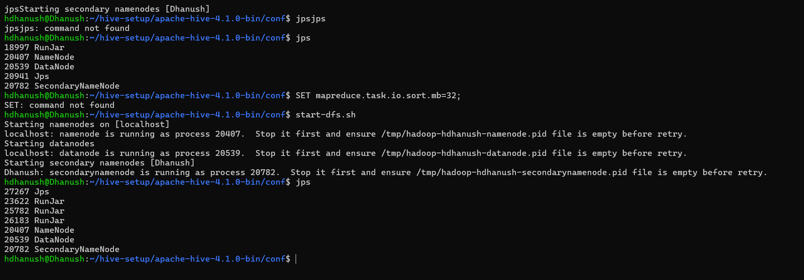
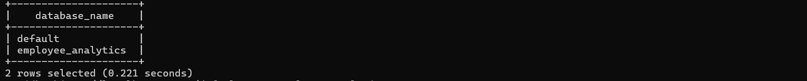
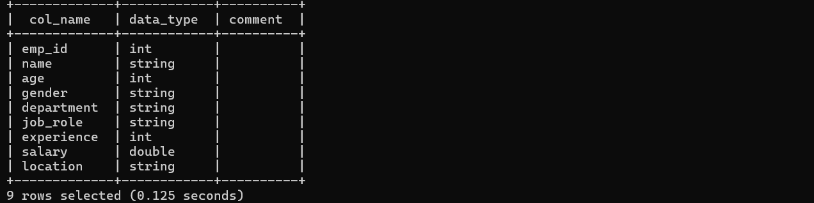
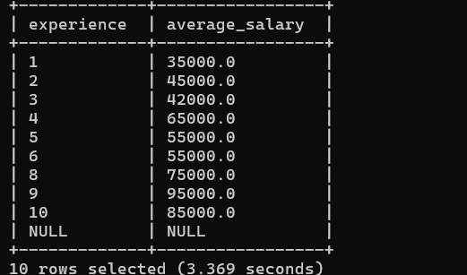
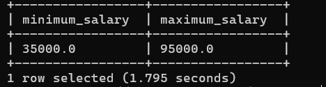
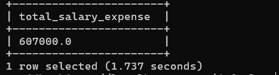

# Employee Salary Analytics Using Apache Hive

## Project Overview
A beginner-level big data project that analyzes employee salary information using Apache Hadoop, HDFS, and Apache Hive.

## Technologies Used
- Ubuntu 24.04 (WSL2)
- Java 17
- Apache Hadoop 3.4.3
- HDFS
- Apache Hive 4.1.0
- Apache Derby
- HiveQL

## Dataset
The dataset contains 10 employee records with employee ID, name, age, gender, department, job role, experience, salary, and location.

## Project Structure
- dataset/employee_salary.csv
- queries/salary_analysis.sql
- README.md

## Analyses Performed
1. Total employee count
2. Overall average salary
3. Department-wise average salary
4. Highest-paid employee
5. Employee count by department
6. Employees earning above 50,000
7. Experience-wise average salary
8. Minimum and maximum salary
9. Total salary expense

## How It Works
1. Store employee data in CSV format.
2. Upload the CSV file to HDFS.
3. Create an external table in Hive.
4. Run HiveQL queries.
5. Analyze the results.

## Key Dataset Results
- Total employees: 10
- Average salary: 60,700
- Highest salary: 95,000
- Lowest salary: 35,000
- Total salary expense: 607,000

## Learning Outcomes
- Hadoop and HDFS fundamentals
- Hive database and external tables
- HiveQL queries
- Data filtering and aggregation
- Salary data analysis

## Project Screenshots

### Hadoop Services

### Hive Database

### Average Salary Analysis

### Department-wise Salary Analysis

### Highest-Paid Employee

### Department Employee Count

### Employees Earning Above 50000

### Experience-wise Salary

### Minimum and Maximum Salary

### Total Salary Expense

